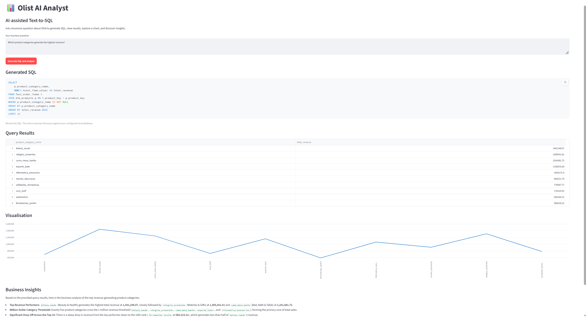

# ⚡ Olist AI Analyst — AI-Powered Text-to-SQL Analytics

**Turn business questions into SQL queries, interactive charts, and AI-generated insights.**

[🚀 Live Demo](https://olist-ai-analyst-8pypnuhfxzaxqry53rplrr.streamlit.app/) · 

## Overview

Olist AI Analyst is an AI-powered analytics application that translates natural-language business questions into SQL queries using Google Gemini. It executes read-only analytical queries against an exported DuckDB database and presents the results through an interactive Streamlit interface.

The project uses the Gold layer of an Olist e-commerce data warehouse to demonstrate how generative AI can make data analysis more accessible to business users.

## Key Features

- **Natural-language to SQL:** Ask business questions without manually writing SQL.
- **AI-powered query generation:** Generate DuckDB-compatible SQL using Google Gemini.
- **Read-only query execution:** Run analytical queries against the exported database.
- **Interactive results:** Explore query outputs in tabular form.
- **Data visualization:** Present analytical results through charts.
- **AI-generated insights:** Translate query results into business-oriented findings.
- **Web-based interface:** Access the application through Streamlit.

## Try These Example Questions

- Which product categories generate the highest revenue?
- How has revenue changed month over month?
- Which sellers generate the most revenue?
- What are the trends in customer reviews and order performance?

## How It Works

1. **Ask:** Enter a business question in natural language.
2. **Understand:** The application provides database schema metadata to Gemini.
3. **Generate:** Gemini creates a DuckDB-compatible, read-only SQL query.
4. **Execute:** The query runs against the exported DuckDB database.
5. **Visualize:** Review the results and explore relevant charts.
6. **Analyze:** Generate AI-assisted insights from the query results.

## Tech Stack

| Technology | Purpose |
|---|---|
| Python | Application logic and data processing |
| Google Gemini API | SQL generation and AI-assisted insights |
| Streamlit | Interactive web application |
| DuckDB | Analytical query execution |
| Pandas | Data handling and result processing |
| Microsoft SQL Server | Original data warehouse and Gold-layer source |
| Git & GitHub | Version control and project hosting |

## Data Architecture

The project follows a layered analytical workflow:

- **Silver layer:** Cleaned and prepared source data.
- **Gold layer:** Analytics-ready views designed for business reporting.
- **DuckDB:** Exported analytical dataset used by the application.
- **Streamlit:** Interface for generating queries, viewing results, and exploring insights.

Exporting the Gold-layer data to DuckDB separates application execution from the original SQL Server instance, enabling deployment without a live connection to the local database.

## Project Structure

| File | Purpose |
|---|---|
| `app.py` | Main Streamlit application |
| `export_to_duckdb.py` | Exports Gold-layer data from SQL Server to DuckDB |
| `check_duckdb.py` | Checks the exported database and its tables |
| `gold_schema.txt` | Schema metadata used to guide SQL generation |
| `requirements.txt` | Python dependencies |
| `olist.duckdb` | Exported analytical database, if included in the repository |
| `.gitignore` | Excludes secrets and unnecessary files |

## Run Locally

### 1. Clone the repository

```bash
git clone https://github.com/ismailvankhar789-wq/olist-ai-analyst.git
cd olist-ai-analyst
```

### 2. Install dependencies

```bash
pip install -r requirements.txt
```

### 3. Configure the Gemini API key

Create a local `.env` file containing:

```env
GEMINI_API_KEY=your_api_key_here
```

Never commit your real API key to GitHub.

### 4. Ensure the database is available

Place `olist.duckdb` in the project directory expected by the application. If the database is not included in the repository, obtain or generate the export before launching the app.

### 5. Launch the application

```bash
python -m streamlit run app.py
```

Open the local URL displayed in the terminal.

## Security and Limitations

- API keys and credentials must remain private.
- The application is designed for read-only analytical SQL queries.
- AI-generated queries and insights may contain errors and should be reviewed.
- Results reflect the data available in the exported database.
- The application does not require a live connection to the original SQL Server database during normal DuckDB-based execution.

## Future Improvements

- Automated dataset refreshes.
- Query caching and performance optimization.
- Enhanced SQL validation and error handling.
- More interactive dashboards and visualizations.
- Expanded business intelligence workflows.

---

**Project focus:** Generative AI · Text-to-SQL · Business Analytics · DuckDB · Streamlit · Python · Data Warehousing · Data Visualization
